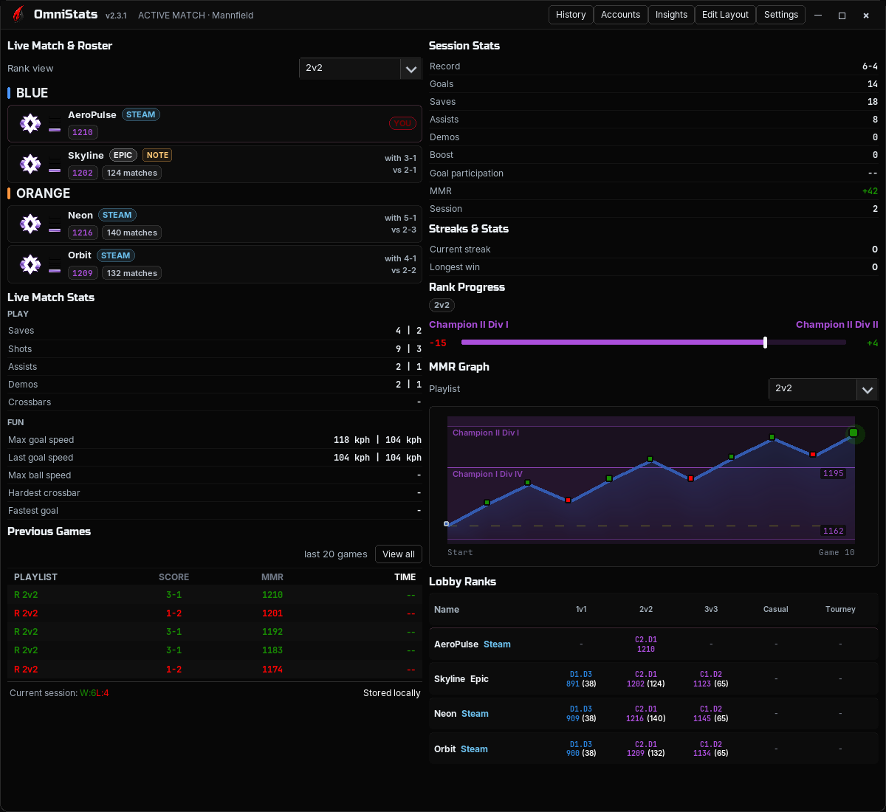
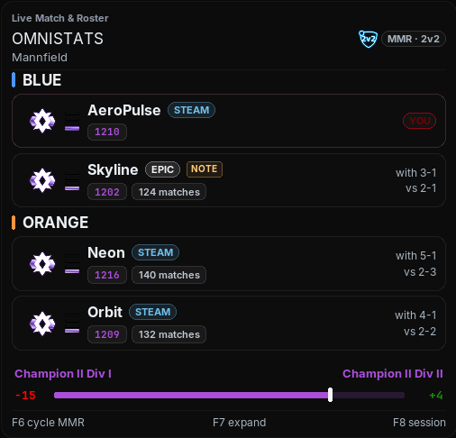
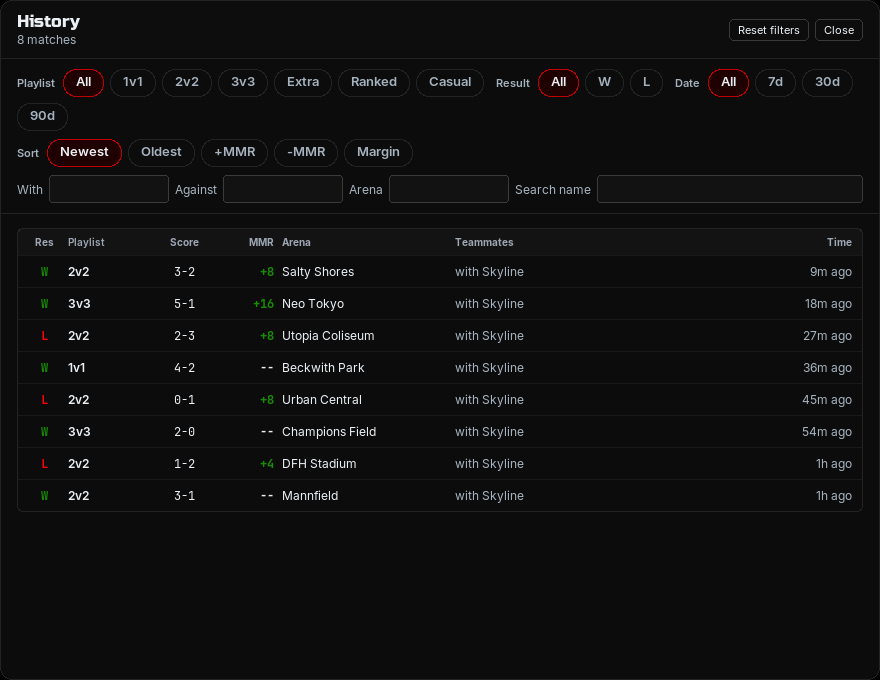
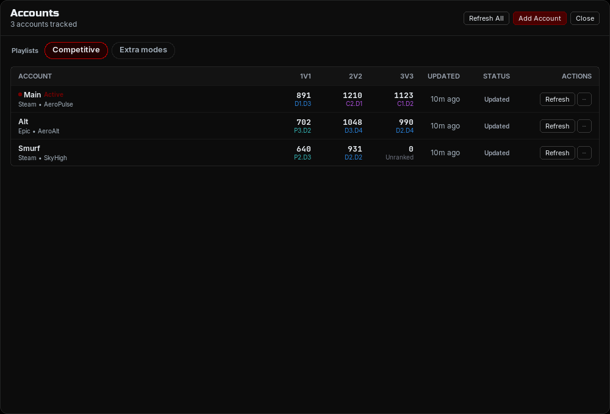

<h1> OmniStats</h1>

[](CMakeLists.txt)
[](docs/BUILDING.md)
[](docs/LINUX.md)
[](LICENSE)
[](https://discord.gg/4KBW35ApvF)

`OmniStats` is a native Windows companion for Rocket League. It connects to the game's loopback Stats API over TCP, tracks live match and session stats, and renders a click-through overlay or second-monitor dashboard using Direct3D 11 and RmlUi. Match history, notes, and tracked accounts stay local in SQLite.

**[Architecture](docs/ARCHITECTURE.md) · [Building](docs/BUILDING.md) · [Privacy](docs/PRIVACY.md) · [Overlay rules](docs/OVERLAY.md) · [Contributing](CONTRIBUTING.md) · [Security](SECURITY.md)**



## Features

- **Lobby ranks.** Rank, division, and MMR across 1v1, 2v2, 3v3, casual, tournaments, and extra modes.
- **Live telemetry.** Real-time saves, shots, assists, demos, and goal and ball speeds for the lobby and for you.
- **Rank progress and MMR graph.** Visual division bands, pre-session baseline, and match deltas. F9 toggles between session and lifetime history.
- **Player scouting.** Head-to-head records (with and vs) computed from local history, plus private player notes.
- **Session insights.** Win rates by teammate, time-of-day trends, and session recap cards exportable as PNG.
- **Account tracking.** Track MMR across all playlists for your main and alts without Rocket League running.
- **Tournament reminders.** Signed-in users get a compact next-tournament countdown in either display mode, brief in-match reminders, and an optional dashboard sound cue. Card visibility and reminders are configured separately.
- **Modular layout.** Draggable, dockable cards with per-card visibility rules, or a separate second-monitor window.
- **Integrations.** Optional automatic replay saving, Ballchasing.com uploads, and Discord Rich Presence.

## Architecture and design

| Subsystem | Implementation | Design notes |
|---|---|---|
| **Game link** | Loopback TCP (Asio) | Connects to Rocket League's built-in Stats API on `127.0.0.1:49123`. Zero DLL injection, zero game memory reads. |
| **Renderer** | Direct3D 11 + RmlUi | Hardware-accelerated HTML/CSS-style DOM. Live telemetry updates text nodes directly via data bindings without rebuilding widgets. |
| **Storage** | SQLite 3 (WAL mode) | Local persistence for matches, player stats, notes, and tracked accounts. Uses versioned schema migrations. |
| **Rank lookup** | OmniStats API + Tracker Network | Official builds include the private OmniStats service module for live ranks, device sign-in, and tournament schedules. Open-source builds link a public stub that uses Tracker Network only (no account sign-in or telemetry). Saved DPAPI credentials are used for device sessions. |
| **Packaging** | WiX Toolset v4 (MSI) | Authenticode-signed installer. The updater checks the MSI's SHA-256 checksum and pinned Authenticode signature before installing. |
| **Test suite** | GoogleTest | Unit and integration tests, including offscreen headless UI tests rendered through DirectX 11 WARP. |

Existing installations receive a one-time device-link prompt after upgrading if they are not linked. Saved API keys migrate in the background before the prompt is considered. If migration fails, Settings > Accounts & services explains how to recover and offers Retry migration without opening a browser. The key stays saved for retry or the next launch. Signing out discards the saved key and prevents an in-flight migration from signing the device back in.

## Supported surfaces

| Surface | Display mode | Description |
|---|---|---|
| **In-game overlay** | Borderless windowed | Click-through HUD rendered over Rocket League. Uses per-container visibility triggers (scoreboard hold, kickoff, goal, podium). |
| **Second monitor** | Exclusive fullscreen or borderless | Separate window with editable, dockable cards. Rocket League stays focused on your primary display. |

## Quick start

Download the signed installer from [omnistats.org](https://omnistats.org/) or build from source. Official installer builds include the private OmniStats service module. Open-source builds from this repository compile against a public stub (ranks via Tracker Network only; no OmniStats account sign-in, telemetry, or crash uploads).

Source builds also need the pinned Discord Social SDK archive. See [Building](docs/BUILDING.md#discord-social-sdk) for its download and path configuration.
```powershell
$env:VCPKG_ROOT = 'C:\src\vcpkg'
cmake --preset windows-release
cmake --build --preset windows-release
ctest --preset windows-release
```

First-run setup checks Rocket League's Stats API configuration, prompts for display mode, and offers a dedicated **Connect live ranks** step. **Continue in browser** opens OmniStats sign-in and PC approval; **Set up later** continues without an account. The browser fallback can copy the sign-in link or verification code. After connecting, choose **Continue** to reach optional integrations and your detected Rocket League account. See [docs/BUILDING.md](docs/BUILDING.md) for full prerequisites and toolchain requirements.

### Linux

OmniStats runs on Linux through Proton in second-monitor mode. Linux support is experimental, and the in-game overlay doesn't work yet. See [docs/LINUX.md](docs/LINUX.md).

## Screenshots

| In-game overlay | Match history | Accounts |
|:---:|:---:|:---:|
|  |  |  |

## Documentation index

| Guide | Description |
|---|---|
| [Architecture](docs/ARCHITECTURE.md) | Data pipeline, reducer state machine, and RmlUi DOM update model |
| [Building](docs/BUILDING.md) | Visual Studio 2022, MSVC, vcpkg, and CMake configuration |
| [Linux](docs/LINUX.md) | Running the Windows build through Proton |
| [Overlay rules](docs/OVERLAY.md) | Container visibility rules, event timers, and layout editing |
| [Privacy](docs/PRIVACY.md) | Network data flows, local storage, diagnostic pings, and retention |
| [Contributing](CONTRIBUTING.md) | Code style, commit conventions, and testing requirements |
| [Security](SECURITY.md) | Vulnerability disclosure policy and release integrity verification |

## License and trademarks

Source available under the [PolyForm Internal Use License 1.0.0](LICENSE). Contributions accepted under [CONTRIBUTION_EXCEPTION.md](CONTRIBUTION_EXCEPTION.md). Redistribution, public mirrors, and competing distributions require written permission.

Rocket League, Psyonix, Epic Games, Tracker Network, Discord, and Ballchasing are trademarks of their respective owners. OmniStats is an independent project and is not affiliated with or endorsed by them.
