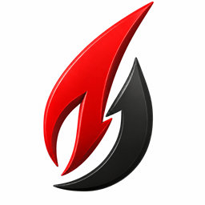
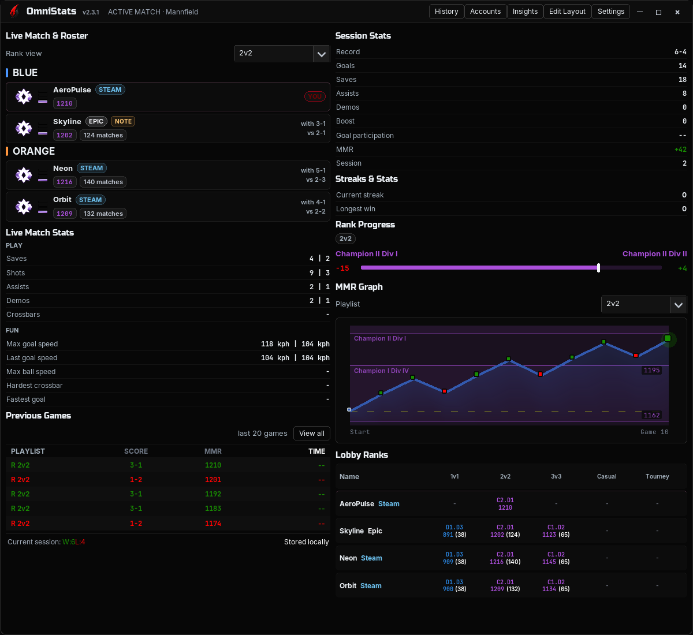
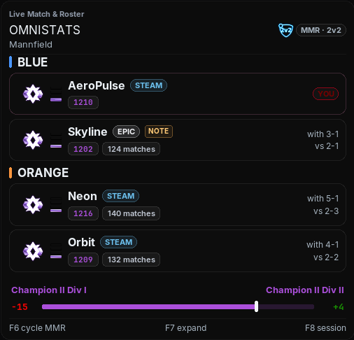
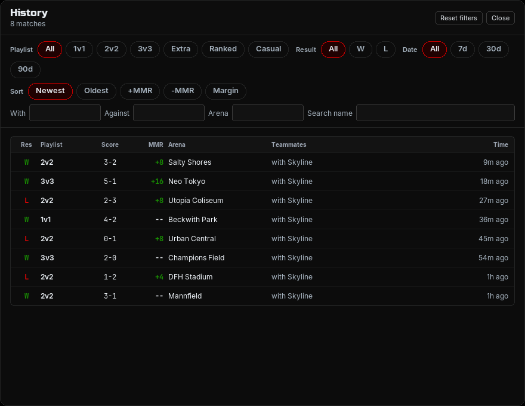
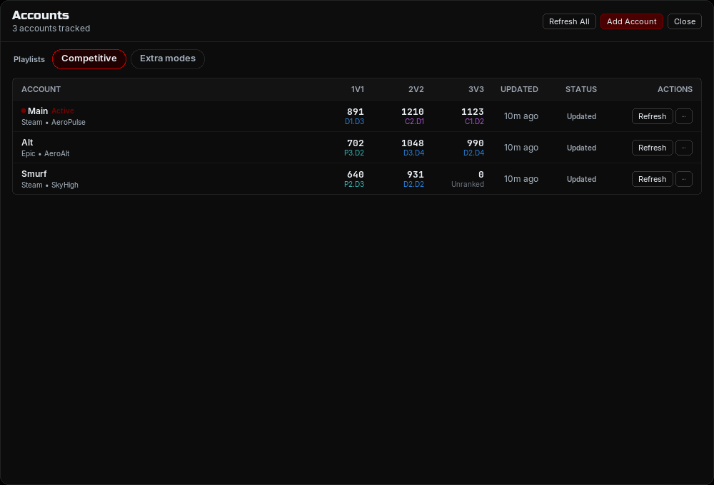

  

<h1 align="center">OmniStats</h1>

Live ranks, match history, and session stats for Rocket League.

  <a href="https://omnistats.org/"><strong>Download for Windows</strong></a> ·
  <a href="#getting-started">Getting started</a> ·
  <a href="https://discord.gg/4KBW35ApvF">Discord</a> ·
  <a href=".github/CONTRIBUTING.md">Contributing</a>

  
  
  
  

OmniStats is a Windows companion app for Rocket League. Follow your lobby's ranks, track your progress, and review past matches in an in-game overlay or a second-monitor dashboard.

## Features

- Live lobby ranks, divisions, and MMR across playlists.
- Match stats, session records, and MMR graphs with division thresholds.
- Match history with timelines, touch and goal maps, and boost and movement stats.
- Teammate records, private player notes, season insights, and shareable session recaps.
- Main and alt account tracking, even when Rocket League isn't running.
- Draggable, dockable cards with visibility rules for individual cards.
- Tournament countdowns and reminders for signed-in users.
- Optional replay saving, Ballchasing uploads, and Discord Rich Presence.

## Getting started

1. Download and run the signed installer from [omnistats.org](https://omnistats.org/).
2. Open OmniStats. Setup checks Rocket League's Stats API configuration and lets you choose your display mode.
3. Connect your OmniStats account for live ranks, or choose **Set up later**. Replay uploads and Discord Rich Presence are optional.

Use **borderless windowed** mode in Rocket League for the in-game overlay. The second-monitor dashboard also works while the game uses exclusive fullscreen.

To switch the active Rocket League identity in OmniStats, open **Accounts** and click **Use** beside the player's name. The selected row shows **Active**. Choose **Auto-detect** to let the next match identify your account. This does not change Rocket League's signed-in account.

Linux support through Proton is experimental and limited to the second-monitor dashboard. See the [Linux guide](docs/LINUX.md).

## Screenshots

| In-game overlay | Match history | Account tracking |
|:---:|:---:|:---:|
|  |  |  |

## How it works

OmniStats reads Rocket League's local Stats API. It does not inject DLLs or read game memory. Match history, player notes, and tracked accounts are stored locally in SQLite.

Official builds send required diagnostics. Rank lookups, replay uploads, and other integrations communicate with external services. See the [privacy guide](docs/PRIVACY.md) for the data each feature sends and which features are optional.

## Development

The client uses C++20, Direct3D 11, and RmlUi. See the [build guide](docs/BUILDING.md) for prerequisites, the Discord Social SDK requirement, and build/test commands. The [architecture guide](docs/ARCHITECTURE.md) covers the code layout and data flow.

Source builds use a public service stub with Tracker Network rank lookup. OmniStats account sign-in, tournament schedules, diagnostics, and crash uploads require the private service module included in official builds.

Read [.github/CONTRIBUTING.md](.github/CONTRIBUTING.md) before opening a PR. For help, join [Discord](https://discord.gg/4KBW35ApvF). Report vulnerabilities privately using the [security policy](.github/SECURITY.md).

## License

OmniStats is source available under the [PolyForm Internal Use License 1.0.0](LICENSE), not open source. The [contribution exception](CONTRIBUTION_EXCEPTION.md) permits forks for proposing changes. Redistribution, public mirrors, and competing distributions require written permission.

OmniStats is not affiliated with or endorsed by Psyonix, Epic Games, Tracker Network, Discord, or Ballchasing. Rocket League and the other product names belong to their respective owners.
