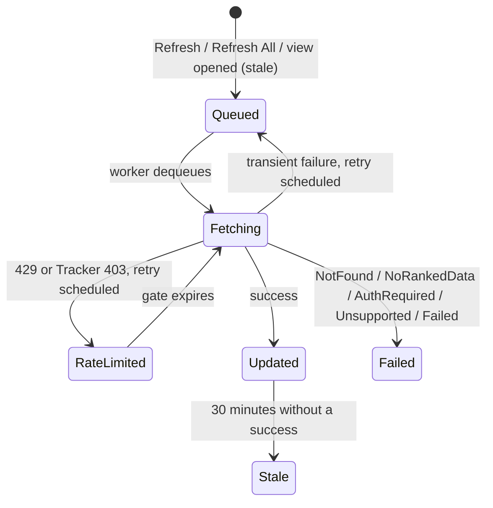

# Account Manager

The Accounts view lists the Rocket League accounts you play on and shows their current MMR side by side. It works without Rocket League running as long as a rank source is configured. Everything is stored in the local `omnistats.db`.

## Storage

Migration 5 adds two tables. Earlier migrations are unchanged.

`TrackedAccounts` holds one row per account.

| Column | Notes |
|---|---|
| `primary_id` | Canonical identity `<Token>\|<accountId>` with the split-screen suffix removed, e.g. `Steam\|76561198000000001`. Tokens are `Epic`, `Steam`, `PS4`, `XboxOne`, `Switch`. |
| `platform`, `platform_account_id` | Unique pair. `platform` stores `epic`, `steam`, `playstation`, `xbox` or `switch`. |
| `nickname` | User label. Empty when not set. |
| `last_known_name` | In-game name seen in telemetry. NULL until observed. |
| `created_at`, `last_seen_at`, `last_refresh_attempt_at`, `last_successful_refresh_at` | Unix seconds. NULL means never. |
| `sort_order` | Insertion order, used as the default table order. |
| `discovery_source` | `manual`, `auto` or `import`. |

`TrackedAccountRanks` keeps the latest successful rating per playlist, keyed by `(primary_id, playlist_key)`. `mmr`, `rank_tier` and `matches_played` are nullable so "not reported" never turns into zero. There is no history table. Graphs stay out of scope.

Removing an account deletes its row and its rank rows in one transaction. `Matches`, `MatchPlayers`, `Sessions` and the stats tables are never touched, so re-adding the account later starts from the same match history.

Other data paths:

- **Export Local Data** writes `tracked_accounts.json` next to the match exports.
- **Delete History & Identity** keeps tracked accounts. They are user-curated, like settings.
- **Merge Database** imports matches only.
- Support bundles list table row counts. Tracked IDs, nicknames and in-game names are added to the log redaction list.

## Identity

`TrackedAccounts::FromPrimaryId` and `ParseManualInput` (`src/core/TrackedAccounts.*`) do all validation.

| Platform | Accepted ID |
|---|---|
| Epic | 32 hexadecimal characters (lowercased) |
| Steam | 17-digit SteamID64 starting with `7656119`, a `steamcommunity.com/profiles/<id>` link, or a Tracker Steam profile link containing the SteamID64 |
| PlayStation, Xbox | Numeric platform ID, up to 20 digits |
| Switch | Hexadecimal ID, up to 32 characters |

Display names, Steam vanity URLs and Tracker links for Epic or consoles are rejected with an explanation. A display name doesn't identify an account, and OmniStats has no API to resolve one. A pasted `Platform|id|0` is accepted when its platform matches the selected one.

## Automatic discovery

`TelemetryReducer::HandleUpdateState` already decides who the local player is. After that decision, it emits `SideEffects::confirmedLocalAccount` when `game.myPrimaryId` is one of this frame's local PC feeds (Steam or Epic players carrying `Boost`/`bOnGround`). It emits again only when the id or in-game name changes, so a match produces one event, not one per tick. Opponents and teammates never reach this path.

`AccountManagerService::ObserveLocalAccount` then:

- registers an unknown identity with `discovery_source = auto` and queues a refresh,
- updates `last_known_name` when the name changed,
- stamps `last_seen_at` once per app run.

Nothing else writes to the database. Nicknames and saved ranks are untouched. The service never writes `game.myPrimaryId`, `last_primary_id` or the MMR history owner. The Settings identity dropdown works as before.

**Import Known Accounts** reads `known_primary_ids` and `last_primary_id`, drops unknown, malformed and already tracked IDs, and inserts the rest with `discovery_source = import`. Config is read, never written.

Accounts without an in-game name get one from local match history. `DatabaseManager::FindLatestPlayerName` returns the name on the most recent `MatchPlayers` row for that identity, with or without the split-screen suffix. The service runs this lookup on its worker when accounts load, when you import, and when you add an account manually. The refresh is queued after the lookup, so Tracker can use the name. The import preview shows the names it found. A successful Tracker refresh also fills an empty name from `platformInfo.platformUserHandle`. Neither source overwrites a name that is already set, and nicknames are never touched.

## Refresh lifecycle

Tracked refreshes go through the existing `MMRFetcher` queue as `MMRRequestReason::TrackedAccount`. They reuse the transport, authentication, URL allow-list, redirect checks, rank parsing, retry budget and rate-limit gate.

Separation from live tracking:

- `PublishProfileResult` returns early for tracked requests. The roster, `myPrimaryId`, MMR history, session graphs, pre-match snapshots, post-match records and the local profile cache are never written.
- All failure paths go through `PublishFetchFailure`. For tracked requests it records an outcome instead of setting `fetched`/`fetchFailed` on a roster entry with the same id.
- Tracked requests have their own dedupe set (`m_trackedQueuedOrInFlight`), separate from roster dedupe.
- Priority is post-match first, then roster, then tracked. A tracked batch waiting in the coalescing window yields as soon as a roster or post-match request becomes ready. Batches never mix purposes and hold at most 16 players.
- `FinishRequest` delivers exactly one terminal event per tracked request to the sink set by `SetTrackedAccountSink`. Progress events (`Fetching`, `Retrying`, `RateLimited` with `retryAt`) are sent as they happen.
- `CancelTrackedAccount` drops queued requests. An in-flight result for a removed account is ignored by the service, and `SaveTrackedAccountRanks` refuses to write ranks for a missing account, so a removed account can't come back.

Batched `/v1/ranks` responses are matched on platform and account ID. A player whose `platform` differs from the request is ignored. An unlabeled player is ignored when two requests in the batch share that account ID.

Service rules (`src/core/AccountManager.*`):

- A success upserts only the playlists the provider reported. Other playlists keep their saved values.
- A failure keeps every saved value and stamps only `last_refresh_attempt_at`.
- Manual refreshes have a 60 second cooldown per account. Refresh All applies the same cooldown.
- Opening the view queues accounts with no success in 30 minutes whose last attempt is over 5 minutes old. There is no timer or polling loop.
- All SQLite work runs on the service worker thread. UI calls only touch memory.

## Provider requirements

`MMRFetcher::ActiveRankProvider()` reports the source:

| Configuration | Provider |
|---|---|
| OmniStats rank API enabled and signed in or API key set | OmniStats API (Tracker fallback if Tracker lookup is also on) |
| Tracker rank lookup on | Tracker |
| Neither | Unavailable. The view shows a banner and refreshes return `ProviderUnavailable`. |

Known limits:

- Tracker looks up Epic, PlayStation, Xbox and Switch profiles by in-game name. An account whose name isn't in local match history can't be refreshed through Tracker. If an OmniStats API key or sign-in exists, the fetcher uses the API for it. Otherwise the account shows "Unsupported" until OmniStats sees the account in a match.
- The OmniStats API omits playlists with zero MMR, and the client treats an empty `skills` array as "No ranked data".
- Tracker 403 blocks trigger the existing circuit breaker, which pauses tracked refreshes along with roster lookups.
- PlayStation, Xbox and Switch IDs are validated by format only. OmniStats can't check that the ID exists until a refresh runs.

## Extension points

- New playlists appear automatically when `PlaylistMetadata` gains a ranked or tournament entry with a Tracker key (`TrackedAccounts::SupportedPlaylists`).
- New fetch outcomes go in `TrackedAccountFetchStatus` and map to `AccountManagerService::RefreshState` in `ApplyFetchEvent`.
- Rank history could be added as a new table fed from the same `Success` event without changing the fetcher.
