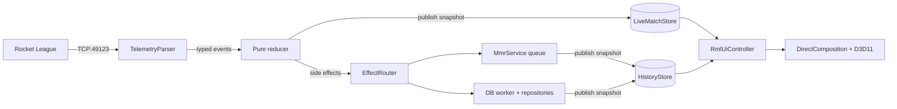

# Architecture

OmniStats is a Windows companion for Rocket League, built with C++20, Direct3D 11, and RmlUi. It reads the game's local Stats API without DLL injection or game-memory access.

## Subsystem overview

| Subsystem | Location | Responsibility |
|---|---|---|
| Application | `src/app/` | Startup, dependency wiring, and shutdown ordering. |
| Configuration | `src/core/config/` | Persisted settings and DPAPI-protected credentials. |
| Telemetry | `src/network/telemetry/` | Receives Stats API packets and parses typed events. |
| Match logic | `src/core/reducer/`, `src/core/game/` | Reduces events into match state, analytics, and side effects. |
| Live state | `src/core/state/LiveMatchStore.*` | Publishes match and session snapshots for the UI. |
| History state | `src/database/store/HistoryStore.*` | Publishes saved-match and rating projections. |
| Database | `src/database/` | SQLite connections, migrations, repositories, and database workers. |
| Rank lookups | `src/network/mmr/` | Request queues, providers, and rank reconciliation. |
| Tracked accounts | `src/core/accounts/` | Account discovery, refreshes, and persistence. |
| UI | `src/ui/rml/`, `src/ui/window/` | Presenters, input, windows, and Direct3D rendering. |
| Updater | `src/updater/` | Separate process that verifies and installs releases. |

## Data pipeline and session lifecycle

`TelemetryParser` emits typed events. `TelemetryReducer::ReduceInPlace` updates match state and analytics, then returns side effects for `EffectRouter` to dispatch to persistence, rank lookup, account tracking, and Discord.

`LiveMatchStore` and `HistoryStore` publish immutable snapshots. UI readers consume those snapshots rather than accessing mutable worker state.

A session ends on game close when configured, or after two hours of inactivity. Resetting clears session totals without deleting lifetime history or notes. Each playlist's MMR baseline comes from the first rating observed before a session match, never from a post-match rating.

Unconfirmed match results stay out of win/loss records and outcome-based insights until confirmed.

## Storage and worker ownership

SQLite stores matches, sessions, analytics, notes, and tracked accounts in `%APPDATA%\omnistats\omnistats.db`. Configuration is stored separately in `config.json`; `SecretStore` protects credentials with user-scoped Windows DPAPI.

Domain repositories operate on supplied SQLite connections and do not own threads. Workers handle database work off the render thread. File-backed databases use a read-only connection pool and a primary write connection protected by a mutex.

Schema changes use versioned migrations with a backup and a transaction per step. A failed step rolls back, leaving the last committed schema intact. An unavailable database stops startup rather than allowing the app to run without persistence.

### Tracked accounts

`AccountManagerService` loads and persists tracked accounts on its worker and reuses the rank-fetch queue. Account results never update the live roster or session MMR history. Removing an account invalidates in-flight requests, so an older response cannot overwrite a re-added account.

Refreshes run on explicit actions and once at startup for stale accounts, not on a timer or when the Accounts view opens. Failed refreshes preserve saved ranks. Removing a tracked account leaves match history intact.

## Background work and shutdown

Network requests, database operations, and Stats API configuration repairs run off the render thread. Services own their workers and stop and join them during shutdown.

Replay discovery and save-key timing are separate from the upload worker, so uploads cannot delay replay saving. Configuration writes use a background saver.

## UI architecture and update model

RmlUi documents remain loaded between frames. Presenters use version counters and data bindings to update changed content rather than rebuild the UI for each telemetry packet.

The overlay is a transparent, click-through window for borderless gameplay. The dashboard is a separate second-monitor window. Both use the Direct3D 11 backend; foreground changes use a WinEvent hook rather than polling every frame.

Release builds embed markup, styles, fonts, and images. See the [build guide](BUILDING.md#editing-the-ui-without-rebuilding) for local UI iteration.

## Updates and external services

The updater runs separately from the client. It verifies signed release manifests, checks for version downgrades, and validates installer signatures before installation.

Official builds include a private service module for OmniStats sign-in, ranks, tournament schedules, and diagnostics. Source builds use the public stub and Tracker Network rank lookup.

See the [privacy guide](PRIVACY.md) for network destinations and transmitted data, and the [security policy](../.github/SECURITY.md) for vulnerability reporting and release verification.
