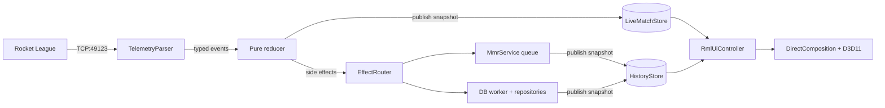

# Architecture

OmniStats is a native Windows desktop companion for Rocket League. It connects to the game's loopback Stats API over TCP, reduces events into a synchronized session state, persists match and player history to SQLite, and renders an overlay and dashboard using DirectX 11 and RmlUi. It does not inject DLLs into or read memory from Rocket League.

## Subsystem overview

| Subsystem | Location | Responsibility |
|---|---|---|
| **Application shell** | `src/app/App.*`, `src/app/ProcessSetup.*` | Startup, shutdown ordering, and dependency injection across subsystems. |
| **Configuration** | `src/core/config/Config.*`, `SecretStore.*` | Table-driven configuration with condition-variable saver and DPAPI-backed secret store. |
| **Telemetry parser** | `src/network/telemetry/TelemetryParser.*` | Asynchronous TCP client (Asio) connected to `127.0.0.1:49123`. Parses JSON into typed event structs. |
| **Pure reducer** | `src/core/reducer/TelemetryReducer*` | Pure function: `(MatchState, Event, Context) -> SideEffects`. Updates match state and emits side effects. |
| **Live match state** | `src/core/state/LiveMatchStore.*` | Owns match lifecycle, active roster, and session tallies. Publishes lock-free immutable snapshots. |
| **History state** | `src/database/store/HistoryStore.*` | Owns playlist rating projections, initial baselines, and recent match cards. Publishes lock-free snapshots. |
| **Database layer** | `src/database/` | SQLite 3 in WAL mode. RAII statements, transactions, reader connection pool, and domain repositories. |
| **Rank lookups** | `src/network/mmr/MmrService*` | Decomposed into request queue, rank providers (Trn, OmniNet), reconciler, and state publisher. |
| **Window & D3D** | `src/ui/Overlay*`, `src/ui/window/` | DirectComposition flip-model swap chain (`DXGI_SWAP_EFFECT_FLIP_SEQUENTIAL`) and WinEvent foreground hook. |
| **UI presenters** | `src/ui/rml/presenters/`, `src/ui/rml/services/` | Surface presenters (overlay, dashboard, settings) and common services (input capture, background tasks, fonts). |
| **Rendering** | `src/ui/rml/backend/RmlRenderInterfaceD3D11.*` | Translates RmlUi 6 geometry, textures, scissor rects, and transforms to D3D11 draw calls. |
| **Auto-updater** | `src/updater/` | Standalone process. Verifies Ed25519 signed release manifest, checks version downgrades, and validates Authenticode signatures. |

## Data pipeline and session lifecycle

1. **Ingestion.** `TelemetryParser` receives JSON packets from Rocket League's loopback interface and emits typed event structs.
2. **Reduction.** `TelemetryReducer::ReduceInPlace` mutates `MatchState` directly, drives `MatchAnalyticsTracker`, and returns a `SideEffects` struct.
3. **Snapshot publication.** `LiveMatchStore` publishes an immutable `LiveMatchSnapshot` via `std::atomic<std::shared_ptr<const LiveMatchSnapshot>>`. UI readers read this snapshot lock-free.
4. **Side effect dispatch.** `EffectRouter::Route` synchronously forwards effects to `DatabaseManager`, `MmrService`, `AccountManagerService`, and `DiscordManager`.
5. **Session boundaries.** A session ends on game close (if `reset_session_on_close` is enabled) or after two hours of inactivity. Resetting generates a session recap record, clears session totals, and increments `sessionGeneration` while leaving lifetime history and player notes intact.
6. **Baselines.** A playlist's session baseline rating (`playlistInitialMmr`) is captured from the first rating observed before any session match in that playlist. It is never seeded from post-match ratings.

Boost collected estimates positive changes in sampled `Boost` values during active play. Countdown and demolition state exclude refill baselines; a pickup ending at 33 still counts. Boost picked up and spent between samples cannot be recovered from this feed.
Journal events use an explicit remaining-clock field when valid, otherwise the last sampled game clock if it is at most five seconds old. `GoalTime` measures round duration, not remaining time. Goal speeds and crossbar impact values retain double precision in the journal; match statistics and analytics store floats.

`MatchAnalyticsTracker` (`src/core/game/MatchAnalytics.*`) builds per-match analytics alongside the reducer from `UpdateState`, `BallHit`, `BoostPickup`, `GoalScored`, `StatfeedEvent`, `PlayerLeft`, kickoff, and pause events. It counts only active play: the round is live from `RoundStarted` (or once the game clock moves, for mid-round joins) until a goal, countdown, or match end, and paused or replay time is excluded. It records per-player hits (speed, height, field third, kickoff first touches), every stat-feed event name, demos inflicted and taken, goals with clock, assister and impact location, kickoff outcomes, possession from `Game.Ball.TeamNum` in 15-second windows, and players leaving. Car state (speed, boost, ground/air/wall, powerslide, supersonic) are captured on every touch.

The local player is the PC account identified from `Game.Target` or roster matching in live, non-spectator updates; replays and demolitions clear the target, so those packets carry no identity signal. Each reducer owns its identity-candidate history. Interleaved reducers cannot reset each other's account-detection state. Configuration snapshots refresh only when `Config::Revision()` changes; unchanged events reuse the cached snapshot.

## Storage schema and repositories

Persisted under `%APPDATA%\omnistats\omnistats.db` using versioned migrations (`PRAGMA user_version`):

- `Matches`: Match timestamps, arena, scores, outcome, playlist, gamemode, and session links.
- `MatchPlayers`: Participant platform IDs, names, teams, and MMR at match time.
- `MatchPlayerStats`: Standard scoreboard stats, touches, max goal speed, and fastest goal time.
- `MatchLocalStats`: Local player metrics including boost collected, demolitions sustained, and crossbar hits.
- `MatchAnalytics`: One versioned JSON document per match (`MatchAnalyticsToJson`) holding the tracker output above. Matches saved before analytics capture have no row.
- `Sessions`: Session start and end timestamps, outcomes, and playlist MMR deltas.
- `TrackedAccounts`: Main and alt accounts with nicknames and current playlist ranks.
- `PlayerNotes`: User-authored scouting notes keyed by normalized platform account identity.
- `ReplayUploads`: Replay file paths, upload queue state, and Ballchasing URLs.

Database operations are split into domain repositories (`MatchRepository`, `SessionRepository`, `HistoryRepository`, `TrackedAccountsRepository`, `PlayerNotesRepository`, `ReplayRepository`, `TransferService`, and `Migrations`). Each repository operates on `sqlite::Connection&` with no internal locks or threads.

`database::sqlite::Statement` and `Transaction` wrap SQLite handles in RAII objects that finalize prepared statements and roll back aborted transactions automatically.

File-backed databases open a pool of three read-only connections (`database::ReaderPool`) after migrations. History, account, session, note, replay, and settings reads lease connections from this pool with RAII lease objects. Each lease begins an isolated read transaction and rolls back on destruction. Writes execute on the primary connection under a write mutex. In-memory databases use the primary connection for reads.

CSV exports prefix formula-like text cells with an apostrophe before applying CSV quoting, including formulas preceded by whitespace. JSON exports preserve the original text.

Provisional `result_pending` matches are excluded from W/L records, streaks, and Insights outcomes/MMR context until confirmation. Merge preserves the flag. Longest streaks scan all confirmed history with constant application memory. The internal recent-match cache still retains provisional rows for confirmation and MMR reconciliation.

Database startup checks existing foreign-key integrity before enabling enforcement on the connection. Declared cascading deletes remove dependent stats and tracked ranks. An integrity violation stops startup and names the affected table in the application log; existing rows are not deleted or rewritten.

Schema v7 indexes `Matches.match_guid` for duplicate checks, post-match MMR updates, replay lookups, and session linking. The index is not unique; duplicate prevention stays in `SaveMatch` so upgrades never fail on older duplicate rows. Date-range filters still convert stored timestamps, because older rows use more than one text format.

## Configuration and startup failures

`Config.cpp` uses a field descriptor table mapping keys to typed member pointers, defaults, and validators. Saving is handled by a condition-variable worker thread that flushes pending changes promptly.

Credentials use user-scoped Windows DPAPI via `SecretStore`. Successfully decrypted legacy machine-scoped credentials are re-encrypted on load; failed decryption preserves the ciphertext. Failed encryption never writes plaintext credentials.

Application, updater, and test executables embed a UTF-8 active-code-page manifest for Unicode profile and game paths. Stats API config detection uses non-throwing filesystem probes.

Stats API checks and repairs follow the game's lookup: `TAGame\Config\TAStatsAPI.ini`, or `DefaultStatsAPI.ini` when `TAStatsAPI.ini` does not exist. Only keys under `[TAGame.MatchStatsExporter_TA]` count; repair rewrites or adds `PacketSendRate=30` and `Port` in that section and leaves every other section unchanged.

An unavailable local database stops startup with a visible error and exit code 1, rather than running without match persistence. The Release build sends stdout and stderr to the rotated application log. C++ termination, pure virtual calls, and invalid CRT parameters write a fatal cause through Win32 file I/O, capture a minidump, and terminate without invoking the failing CRT stream again.

The application and updater open their logs in shared mode. If a log cannot be opened, output goes to `NUL` instead of a closed stream, so a second process or an external lock cannot crash startup or a concurrent updater run.

The Settings and onboarding Stats API repair runs on a background thread. The render thread shows progress, and the result is published on the next UI update. The repair wait stops on shutdown and gives up after 10 minutes.

## UI architecture and update model

- **RmlUi DOM.** RmlUi templates (`resources/rml/*.rml`) are compiled into persistent DOM trees rather than being reconstructed every frame.
- **Granular invalidation.** `RmlUiController` checks version counters across session state, history, and layout configuration to redraw only the affected widgets or views.
- **Dual surfaces.**
  - *Overlay:* Borderless transparent DirectComposition window (`WS_EX_NOREDIRECTIONBITMAP | WS_EX_LAYERED | WS_EX_TRANSPARENT`) with flip-model presentation and configurable visibility triggers (scoreboard hold, kickoff countdown, goal, podium). Layered style is required for cross-process click-through; opening Settings removes the transparent style.
  - *Dashboard:* Second-monitor window with draggable, dockable cards managed through `DashboardLayoutConfig`.
- **Hardware rendering.** `RmlRenderInterfaceD3D11` issues batched, hardware-accelerated draw calls with premultiplied alpha blending directly to the flip-model swap chain.

  If composition swap-chain creation returns `E_NOTIMPL`, rendering uses an opaque HWND swap chain instead. Window styles then omit `WS_EX_NOREDIRECTIONBITMAP` and `WS_EX_LAYERED`, including during setup and device recreation. Other swap-chain creation errors remain fatal.

- **Foreground hook.** `ForegroundDetector` tracks Rocket League focus using a WinEvent hook (`EVENT_SYSTEM_FOREGROUND`) instead of per-frame polling.
- **Surface presenters.** UI markup generation is divided among `OverlayPresenter`, `DashboardPresenter`, and `SettingsPresenter`. Common interaction, font loading, and background tasks are managed by `InputCaptureService`, `FontService`, and `BackgroundTaskService`.
- **Data models.** Fast counters update through the `live` data model. Enriched widget models (`OverlayWidgetModel`) provide data-bound collections for roster, lobby ranks, graph series, and previous games.

The app and UI test executable embed the same named RCDATA resources for fonts, templates, and images. Tests do not depend on the launch directory to load the UI.

## External network boundaries

| Destination | Purpose | Protocol | Trigger |
|---|---|---|---|
| `127.0.0.1:49123` | In-game match telemetry | TCP (Loopback) | Active match |
| OmniStats service | Device sign-in, rank lookups, tournament schedules, diagnostic ping, and crash dumps | HTTPS (OmniStats service module; official builds only) | Optional rank lookup, tournament check, startup, or crash |
| `omnistats.org` | Version checks and announcement feed | HTTPS | Startup / Periodic |
| Tracker Network | Public player rank and MMR lookup | HTTPS | Optional rank lookup |
| `ballchasing.com` | Replay file uploads | HTTPS | Post-match (opt-in) |
| Discord (Local IPC) | Rich Presence status | Named pipe | Active match (opt-in) |
