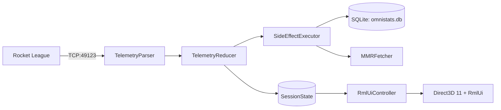

# Architecture

OmniStats is a native Windows desktop companion for Rocket League. It connects to the game's loopback Stats API over TCP, reduces events into a synchronized session state, persists match and player history to SQLite, and renders an overlay and dashboard using DirectX 11 and RmlUi. It does not inject DLLs into or read memory from Rocket League.

## Subsystem overview

| Subsystem | Location | Responsibility |
|---|---|---|
| **Telemetry** | `src/network/telemetry/TelemetryParser.*` | Asynchronous TCP client (Asio) connected to `127.0.0.1:49123`. Deserializes JSON event feeds. |
| **State reduction** | `src/core/reducer/TelemetryReducer*` | Pure state machine. Processes raw match events, handles overtime and disconnects, and emits side effects. |
| **Storage** | `src/database/` | SQLite 3 in WAL mode. Separate migration, match-write, history-query, session, account, note, replay, and transfer implementation units. |
| **Rank lookups** | `src/network/mmr/MMRFetcher*` | Bounded worker queue with rate limiting. Requests up to 8 player ratings per batch via the OmniStats service module in official builds, or from Tracker Network in source builds. |
| **Window & D3D** | `src/ui/Overlay*`, `src/ui/window/` | Win32 host window, swap chain management, DPI scaling, and borderless click-through overlay behavior. |
| **UI controller** | `src/ui/rml/controller/RmlUiController*` | Snapshots state, invalidates widgets on version changes, and translates input events. |
| **Rendering** | `src/ui/rml/backend/RmlRenderInterfaceD3D11.*` | Translates RmlUi 6 geometry, compiled textures, scissor rects, and transforms to D3D11 draws. |
| **Data model** | `src/ui/rml/controller/RmlLiveModel.*` | RmlUi data bindings. Telemetry ticks update bound DOM text nodes directly without rebuilding elements. |
| **Auto-updater** | `src/updater/` | Standalone updater process. Checks the MSI's SHA-256 checksum and pinned Authenticode signature, then runs Windows Installer. |

## Data pipeline and session lifecycle

1. **Ingestion.** `TelemetryParser` receives JSON packets from Rocket League's loopback interface.
2. **Reduction.** `TelemetryReducer` updates `SessionState` under a shared lock. Fast counters and live speeds update the `live` data model without touching the DOM tree.
3. **Side effects.** Non-render work (saving matches to SQLite, queueing Ballchasing uploads, triggering rank lookups) is emitted as discrete effects and executed on dedicated worker threads.
4. **Session boundaries.** A session ends on game close (if `reset_session_on_close` is enabled) or after two hours of inactivity. Resetting generates a session recap record, clears session totals, and increments `sessionGeneration` while leaving lifetime history and player notes intact.
5. **Baselines.** A playlist's session baseline rating (`playlistInitialMmr`) is captured from the first rating observed before any session match in that playlist. It is never seeded from post-match ratings.

Boost collected estimates positive changes in sampled `Boost` values during active play. Countdown and demolition state exclude refill baselines; a pickup ending at 33 still counts. Boost picked up and spent between samples cannot be recovered from this feed.

`MatchAnalyticsTracker` (`src/core/game/MatchAnalytics.*`) builds per-match analytics alongside the reducer from `UpdateState`, `BallHit`, `BoostPickup`, `GoalScored`, `StatfeedEvent`, `PlayerLeft`, kickoff and pause events. It counts only active play: the round is live from `RoundStarted` (or once the game clock moves, for mid-round joins) until a goal, countdown or match end, and paused or replay time is excluded. It records per-player hits (speed, height, field third, kickoff first touches), every stat-feed event name, demos inflicted and taken, goals with clock, assister and impact location, kickoff outcomes, possession from `Game.Ball.TeamNum` in 15-second windows, and players leaving. Car state (speed, boost, ground/air/wall, powerslide, supersonic) arrives during live play only for players on your team, carried by entries with `bHasCar`; zero and false fields are omitted, so a missing field in such an entry means 0 or false. Opponents' car state appears only during goal replays, which are excluded. `BallHit` fires on every physics frame a car stays in contact with the ball, so a player's hits that each arrive within 0.03 seconds of the previous one form one touch; on recorded online matches this matches the game's `Touches` stat to within one or two per player. The live `GoalScored` event carries a stale `ImpactLocation`; the game repeats `GoalScored` with an empty scorer when the goal replay ends, and that repeat supplies the goal's location. Car and ball speeds are normalized to km/h from the observed value range, because live payloads and the published Stats API units disagree. `BoostPickup` is spectator-only and was absent from a recorded online match, so pad counts are usually inferred from boost increases (above 12 counts as a big pad) and steals are unavailable.

Each reducer owns its identity-candidate history. Interleaved reducers cannot reset each other's account-detection state. Configuration snapshots refresh only when `Config::Revision()` changes; unchanged events reuse the cached snapshot.

## Storage schema

Persisted under `%APPDATA%\omnistats\omnistats.db` using versioned migrations (`PRAGMA user_version`):

- `Matches`: Match timestamps, arena, scores, outcome, playlist, gamemode, and session links.
- `MatchPlayers`: Participant platform IDs, names, teams, and MMR at match time.
- `MatchPlayerStats`: Standard scoreboard stats, touches, max goal speed, and fastest goal time.
- `MatchLocalStats`: Local player metrics including boost collected, demolitions sustained, and crossbar hits.
- `MatchAnalytics`: One versioned JSON document per match (`MatchAnalyticsToJson`) holding the tracker output above. Matches saved before analytics capture have no row.
- `Sessions`: Session start and end timestamps, outcomes, and playlist MMR deltas.
- `TrackedAccounts`: Main and alt accounts with nicknames and current playlist ranks.
- `PlayerNotes`: User-authored scouting notes keyed by normalized platform account identity.
- `ReplayUploads`: Replay file paths, upload queue state, and Ballchasing URLs.

CSV exports prefix formula-like text cells with an apostrophe before applying CSV quoting, including formulas preceded by whitespace. JSON exports preserve the original text.

Provisional `result_pending` matches are excluded from W/L records, streaks and Insights outcomes/MMR context until confirmation. Merge preserves the flag. Longest streaks scan all confirmed history with constant application memory. The internal recent-match cache still retains provisional rows for confirmation and MMR reconciliation.

Database startup checks existing foreign-key integrity before enabling enforcement on the connection. Declared cascading deletes remove dependent stats and tracked ranks. An integrity violation stops startup and names the affected table in the application log; existing rows are not deleted or rewritten.

File-backed databases open a separate read-only connection after migrations. History, account, session, note, replay, and settings reads lease that connection under a reader mutex and use a transaction snapshot for multi-query consistency. Writes keep the writer connection and its mutex. In-memory databases and installations where the reader cannot open use the writer connection for reads. Session queries may still run required backfill writes before acquiring their read snapshot.

Schema v7 indexes `Matches.match_guid` for duplicate checks, post-match MMR updates, replay lookups and session linking. The index is not unique; duplicate prevention stays in `SaveMatch` so upgrades never fail on older duplicate rows. Date-range filters still convert stored timestamps, because older rows use more than one text format.

Some local builds already advanced `user_version` past 10, so `MatchAnalytics` is created by migration v11 and by an idempotent check after the migration loop.

Session backfill commits each chunk only when every selected match was linked. A chunk that links nothing ends the run and logs the SQLite error, so a locked or read-only database cannot stall the database worker.

## Configuration and startup failures

Config fields load independently. Wrong types, out-of-range numbers and non-finite values leave that field at its default without discarding valid settings or credentials. A malformed JSON document still follows the corrupt-file recovery path.

Credentials use user-scoped Windows DPAPI. Successfully decrypted legacy machine-scoped credentials are re-encrypted on load; failed decryption preserves the ciphertext. Failed encryption never writes plaintext credentials.

Application, updater and test executables embed a UTF-8 active-code-page manifest for Unicode profile and game paths. Stats API config detection uses non-throwing filesystem probes.

Stats API checks and repairs follow the game's lookup: `TAGame\Config\TAStatsAPI.ini`, or `DefaultStatsAPI.ini` when `TAStatsAPI.ini` does not exist. Only keys under `[TAGame.MatchStatsExporter_TA]` count; repair rewrites or adds `PacketSendRate=30` and `Port` in that section and leaves every other section unchanged.

An unavailable local database stops startup with a visible error and exit code 1, rather than running without match persistence. The Release build sends stdout and stderr to the rotated application log. C++ termination, pure virtual calls and invalid CRT parameters write a fatal cause through Win32 file I/O, capture a minidump and terminate without invoking the failing CRT stream again.

The application and updater open their logs in shared mode. If a log cannot be opened, output goes to `NUL` instead of a closed stream, so a second process or an external lock cannot crash startup or a concurrent updater run.

The Settings and onboarding Stats API repair runs on a background thread. The render thread shows progress, and the result is published on the next UI update. The repair wait stops on shutdown and gives up after 10 minutes.

## UI architecture and update model

- **RmlUi DOM.** RmlUi templates (`resources/rml/*.rml`) are compiled into persistent DOM trees rather than being reconstructed every frame.
- **Granular invalidation.** `RmlUiController` checks version counters across session state, history, and layout configuration to redraw only the affected widgets or views.
- **Dual surfaces.**
  - *Overlay:* Borderless transparent window with click-through support and configurable container visibility triggers (scoreboard hold, kickoff countdown, goal, podium).
  - *Dashboard:* Second-monitor window with draggable, dockable cards managed through `DashboardLayoutConfig`.
- **Hardware rendering.** `RmlRenderInterfaceD3D11` issues batched, hardware-accelerated draw calls with premultiplied alpha blending directly to the swap chain.

## External network boundaries

| Destination | Purpose | Protocol | Trigger |
|---|---|---|---|
| `127.0.0.1:49123` | In-game match telemetry | TCP (Loopback) | Active match |
| OmniStats service | Device sign-in, rank lookups, tournament schedules, diagnostic ping, and crash dumps | HTTPS (OmniStats service module; official builds only) | Optional rank lookup, tournament check, startup, or crash |
| `omnistats.org` | Version checks and announcement feed | HTTPS | Startup / Periodic |
| Tracker Network | Public player rank and MMR lookup | HTTPS | Optional rank lookup |
| `ballchasing.com` | Replay file uploads | HTTPS | Post-match (opt-in) |
| Discord (Local IPC) | Rich Presence status | Named pipe | Active match (opt-in) |
