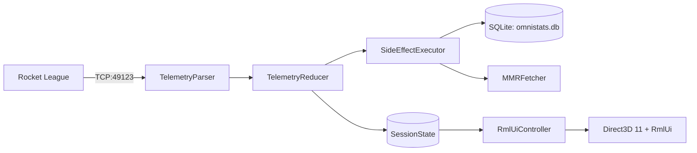

# Architecture

OmniStats is a native Windows desktop companion for Rocket League. It connects to the game's loopback Stats API over TCP, reduces events into a synchronized session state, persists match and player history to SQLite, and renders an overlay and dashboard using DirectX 11 and RmlUi. It does not inject DLLs into or read memory from Rocket League.

## Subsystem overview

| Subsystem | Location | Responsibility |
|---|---|---|
| **Telemetry** | `src/network/telemetry/TelemetryParser.*` | Asynchronous TCP client (Asio) connected to `127.0.0.1:49123`. Deserializes JSON event feeds. |
| **State reduction** | `src/core/reducer/TelemetryReducer*` | Pure state machine. Processes raw match events, handles overtime and disconnects, and emits side effects. |
| **Storage** | `src/database/DatabaseManager.*` | SQLite 3 in WAL mode. Manages schema migrations with pre-migration backups, asynchronous batch writes, and encounter queries. |
| **Rank lookups** | `src/network/mmr/MMRFetcher*` | Bounded worker queue with rate limiting. Requests player ratings from the OmniStats API (using Ed25519-signed requests) or Tracker Network. |
| **Window & D3D** | `src/ui/Overlay*`, `src/ui/window/` | Win32 host window, swap chain management, DPI scaling, and borderless click-through overlay behavior. |
| **UI controller** | `src/ui/rml/controller/RmlUiController*` | Snapshots state, invalidates widgets on version changes, and translates input events. |
| **Rendering** | `src/ui/rml/backend/RmlRenderInterfaceD3D11.*` | Translates RmlUi 6 geometry, compiled textures, scissor rects, and transforms to D3D11 draws. |
| **Data model** | `src/ui/rml/controller/RmlLiveModel.*` | RmlUi data bindings. Telemetry ticks update bound DOM text nodes directly without rebuilding elements. |
| **Auto-updater** | `src/updater/` | Standalone updater process. Handles SHA-256 validation, extraction, and binary replacement. |

## Data pipeline and session lifecycle

1. **Ingestion.** `TelemetryParser` receives JSON packets from Rocket League's loopback interface.
2. **Reduction.** `TelemetryReducer` updates `SessionState` under a shared lock. Fast counters and live speeds update the `live` data model without touching the DOM tree.
3. **Side effects.** Non-render work (saving matches to SQLite, queueing Ballchasing uploads, triggering rank lookups) is emitted as discrete effects and executed on dedicated worker threads.
4. **Session boundaries.** A session ends on game close (if `reset_session_on_close` is enabled) or after two hours of inactivity. Resetting generates a session recap record, clears session totals, and increments `sessionGeneration` while leaving lifetime history and player notes intact.
5. **Baselines.** A playlist's session baseline rating (`playlistInitialMmr`) is captured from the first rating observed before any session match in that playlist. It is never seeded from post-match ratings.

## Storage schema

Persisted under `%APPDATA%\omnistats\omnistats.db` using versioned migrations (`PRAGMA user_version`):

- `Matches`: Match timestamps, arena, scores, outcome, playlist, gamemode, and session links.
- `MatchPlayers`: Participant platform IDs, names, teams, and MMR at match time.
- `MatchPlayerStats`: Standard scoreboard stats, touches, max goal speed, and fastest goal time.
- `MatchLocalStats`: Local player metrics including boost collected, demolitions sustained, and crossbar hits.
- `Sessions`: Session start and end timestamps, outcomes, and playlist MMR deltas.
- `TrackedAccounts`: Main and alt accounts with nicknames and current playlist ranks.
- `PlayerNotes`: User-authored scouting notes keyed by normalized platform account identity.
- `ReplayUploads`: Replay file paths, upload queue state, and Ballchasing URLs.

## Configuration and startup failures

Config fields load independently. Wrong types, out-of-range numbers and non-finite values leave that field at its default without discarding valid settings or credentials. A malformed JSON document still follows the corrupt-file recovery path.

Credentials use user-scoped Windows DPAPI. Successfully decrypted legacy machine-scoped credentials are re-encrypted on load; failed decryption preserves the ciphertext. Failed encryption never writes plaintext credentials.

Application, updater and test executables embed a UTF-8 active-code-page manifest for Unicode profile and game paths. Stats API config detection uses non-throwing filesystem probes.

Stats API checks and repairs follow the game's lookup: `TAGame\Config\TAStatsAPI.ini`, or `DefaultStatsAPI.ini` when `TAStatsAPI.ini` does not exist. Only keys under `[TAGame.MatchStatsExporter_TA]` count; repair rewrites or adds `PacketSendRate=30` and `Port` in that section and leaves every other section unchanged.

## UI architecture and update model

- **RmlUi DOM.** RmlUi templates (`resources/rml/*.rml`) are compiled into persistent DOM trees rather than being reconstructed every frame.
- **Granular invalidation.** `RmlUiController` checks version counters across session state, history, and layout configuration to redraw only the affected widgets or views.
- **Dual surfaces.**
  - *Overlay:* Borderless transparent window with click-through support and configurable container visibility triggers (scoreboard hold, kickoff countdown, goal, podium).
  - *Dashboard:* Second-monitor window with draggable, dockable cards managed through `DashboardLayoutConfig`.
- **Hardware rendering.** `RmlRenderInterfaceD3D11` issues batched, hardware-accelerated draw calls with premultiplied alpha blending directly to the swap chain.

## External network boundaries

| Destination | Purpose | Protocol | Trigger |
|---|---|---|---|
| `127.0.0.1:49123` | In-game match telemetry | TCP (Loopback) | Active match |
| `api.omnistats.org` | Device sign-in and rank lookups | HTTPS (Ed25519) | Optional rank lookup |
| `api.omnistats.org` | Startup diagnostic ping and crash dumps | HTTPS | Startup / On crash (opt-in) |
| `omnistats.org` | Version checks and announcement feed | HTTPS | Startup / Periodic |
| Tracker Network | Public player rank and MMR lookup | HTTPS | Optional rank lookup |
| `ballchasing.com` | Replay file uploads | HTTPS | Post-match (opt-in) |
| Discord (Local IPC) | Rich Presence status | Named pipe | Active match (opt-in) |
